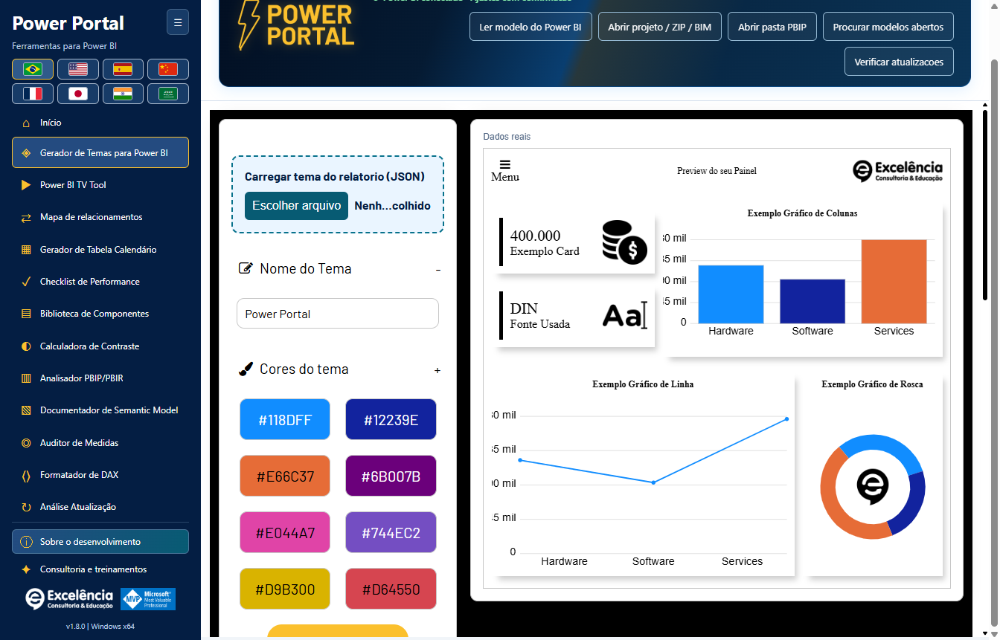
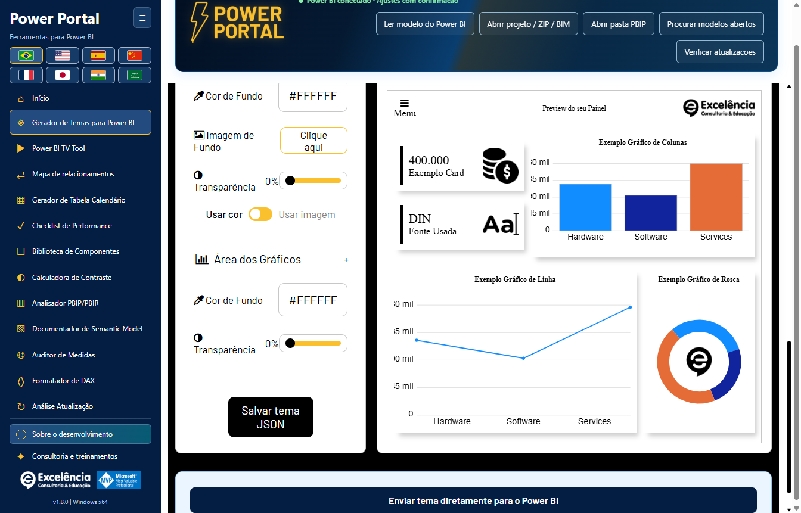
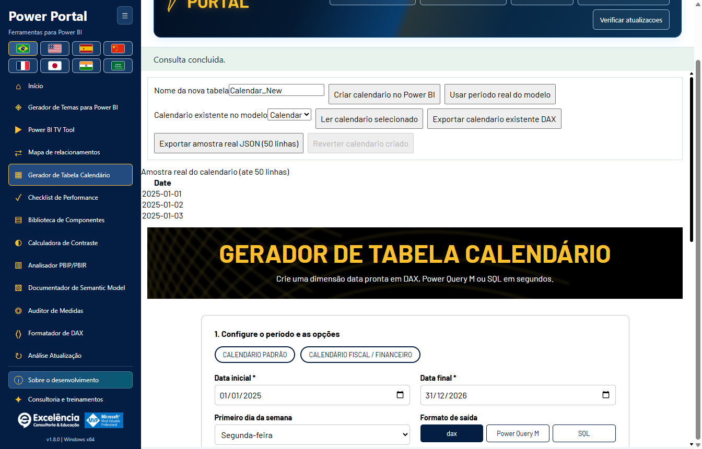
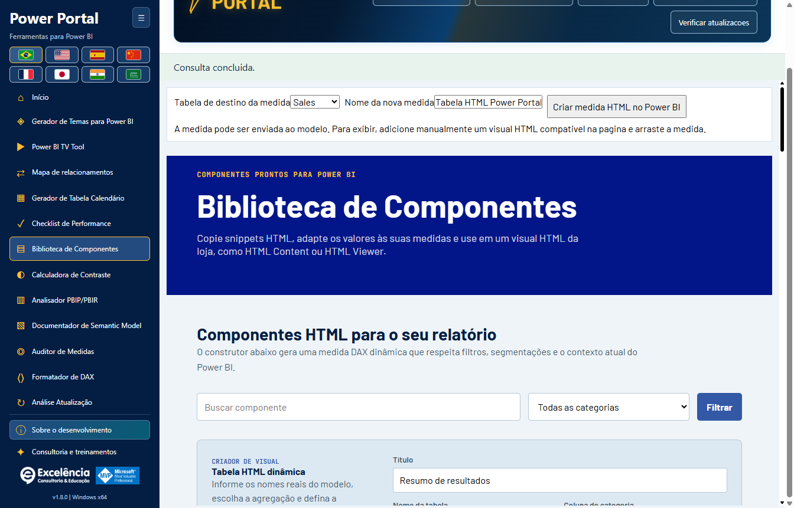
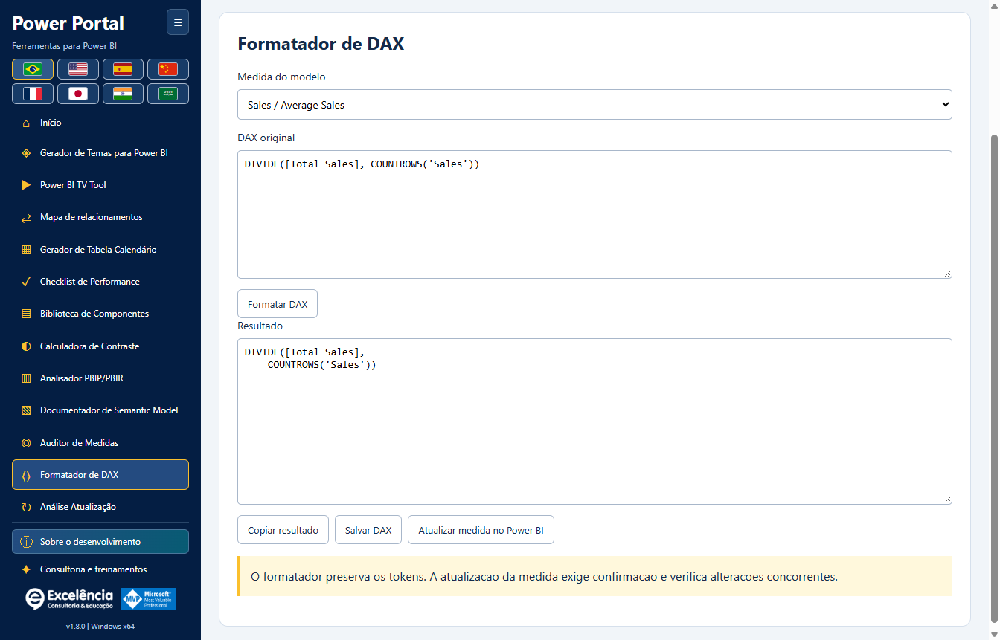
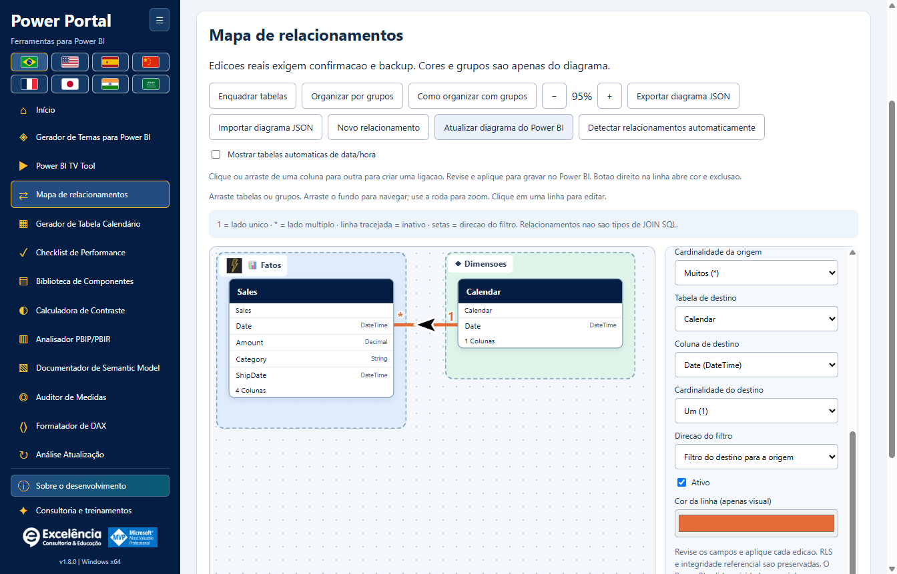
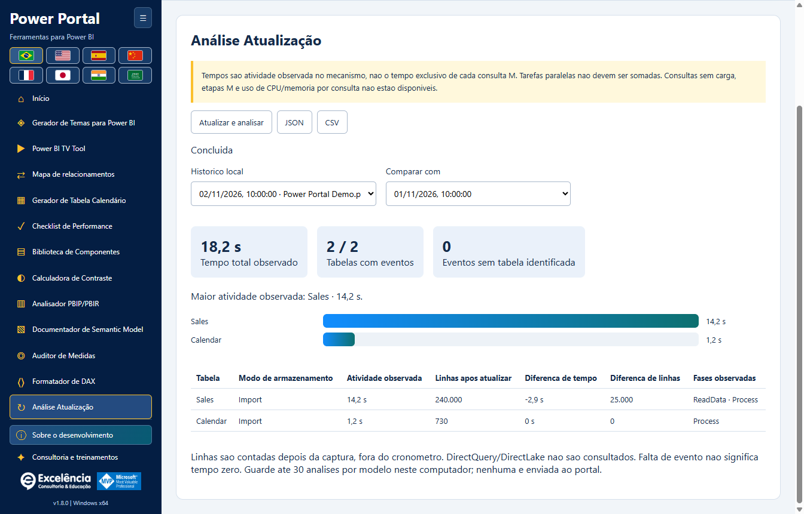

# Uso e segurança do modelo

<!-- language-selector -->
[🇺🇸 English](../USAGE.md) · [🇧🇷 Português](USAGE.md) · [🇪🇸 Español](../es/USAGE.md) · [🇨🇳 简体中文](../zh-CN/USAGE.md) · [🇫🇷 Français](../fr/USAGE.md) · [🇯🇵 日本語](../ja/USAGE.md) · [🇮🇳 हिन्दी](../hi/USAGE.md) · [🇸🇦 العربية](../ar/USAGE.md)
<!-- /language-selector -->

[Voltar ao início](../../README.pt-BR.md)

O cabecalho animado do Power Portal agora incorpora o nome do arquivo, o status da conexao e os cinco botoes de leitura/importacao/busca/atualizacao. A faixa separada abaixo do banner foi removida para liberar espaco. O conteudo se reorganiza dentro do cabecalho em janelas menores e nos oito idiomas, incluindo arabe. Confirmacoes, avisos e comportamento das atualizacoes foram preservados.

O Mapa de relacionamentos agora fica imediatamente depois do TV Tool no menu lateral e na galeria inicial. O bloco generico Dados reais do modelo foi removido do Gerador de Tabela Calendario e da Biblioteca de Componentes. Os controles proprios de leitura e envio continuam; o botao de periodo real usa o calendario selecionado dentro da ferramenta. As capas da pagina inicial foram redesenhadas como ilustracoes vetoriais locais sem texto embutido. Titulos, descricoes e acoes ficam fora das imagens e acompanham o idioma selecionado. Arraste uma coluna de origem para outra tabela para abrir o dialogo de relacionamento real e escolher a coluna de destino. Soltar em uma coluna ja a preseleciona. Revise cardinalidade, filtro e estado ativo; depois valide e aplique com confirmacao nativa e backup BIM.

A validacao verifica tipos, pares duplicados, ligacoes diretas ativas e contagens reais de linhas e valores distintos nas duas colunas, sem amostragem. Duplicatas no lado Um sao rejeitadas. As consultas tem limite de 20 segundos e falhas explicitas. Validar nunca grava. Aplicar repete a validacao, e o engine verifica chaves e ambiguidades de filtro ao confirmar. O rascunho tracejado nao e um relacionamento salvo; apenas a gravacao confirmada com sucesso o cria. Salve o PBIX depois. Testes e prints usam dados sinteticos, sem alterar PBIX de clientes.

## Primeira execução

Inicie pela guia Ferramentas externas do Power BI para conectar automaticamente ao modelo local, ou pelo atalho Windows para usar ferramentas offline/importar um projeto. A página inicial exibe as doze ferramentas. **Início** retorna à galeria sem descartar o modelo carregado.

Use o botão de recolher o menu e as bandeiras quando precisar. O cabeçalho de conexão mostra o nome do arquivo quando disponível, em vez do GUID interno do banco.

Após conectar, um status verde compacto no cabeçalho substitui o aviso maior de conexão. Sua dica lembra de salvar uma cópia separada do PBIX. As alterações suportadas continuam exigindo confirmação.

[Passo a passo ilustrado de todas as telas e interações com o Power BI](SCREENSHOTS.md).

## Trabalho somente leitura

Leia metadados, consulte pequenas amostras, audite medidas, verifique contraste, formate DAX ou exporte documentação sem enviar gravações. Os dados representam o modelo semântico **sem os filtros ou segmentações da página ativa do relatório**.

Amostras continuam limitadas a 50 linhas e consultas a 20 segundos. Os dados do calendario sao lidos pelo seletor e pela previa da propria ferramenta; o bloco generico nao aparece mais no Gerador de Calendario nem na Biblioteca de Componentes. O status da conexao fica no cabecalho.

Importações locais aceitam BIM, pastas TMDL/PBIP/PBIR suportadas e ZIPs. São somente leitura. O importador não lê um PBIX bruto: abra-o no Power BI Desktop e conecte localmente.

Limites de ZIP: 50 MB compactados, 500 MB extraídos, 10.000 arquivos e 64 MB por entrada. Links simbólicos e pastas como `.git`, `.pbi` e `node_modules` não são percorridos. Importe um modelo semântico por vez.

## Temas

1. No Power BI Desktop, salve o JSON do tema atual pelo menu Temas se quiser editá-lo.
2. No gerador de temas do Power Portal, use a área destacada **Carregar tema do relatório (JSON)**. Uma conexão TOM não consegue recuperar o tema do relatório.
3. Edite cores/fontes/fundos observando a prévia local em tempo real.
4. Exporte JSON ou role até o final, abaixo das configurações e da prévia, e escolha **Enviar tema diretamente para o Power BI**.
5. Confira o nome do arquivo na confirmação, aprove e não interaja com o Power BI durante a importação.
6. Salve o PBIX no Power BI quando estiver satisfeito.

O envio direto usa **Automação de Interface visível**, incluindo o diálogo de arquivos do Desktop. O aplicativo verifica o tema resultante exportando-o e comparando as propriedades enviadas. O JSON gerado continua disponível se a automação falhar. Versões, idiomas ou mudanças na interface do Desktop podem impedir a automação.

Não há uma API genérica suportada do Desktop para aplicar um tema a qualquer PBIX aberto sem diálogos. O `applyTheme` de relatórios incorporados é outra API e não é usado como alternativa para o Desktop.

A prévia em tempo real é uma implementação local da tela de temas do site, não uma representação idêntica em pixels de todos os visuais do Power BI.

## Operações de gravação

As gravações suportadas no modelo semântico são criação de medida, atualização do DAX da medida selecionada, criação de nova tabela calendário calculada e criação/edição/exclusão de relacionamentos.

Antes de qualquer gravação:

1. **Salve uma cópia separada do PBIX.**
2. Confira o arquivo/modelo selecionado e o DAX proposto.
3. Aceite a confirmação nativa (Cancelar é o padrão).
4. Guarde o caminho do backup exibido e confira o resultado no Power BI.
5. Salve o PBIX você mesmo; o aplicativo não o salva automaticamente.

O backup BIM dos metadados deve ser concluído antes de confirmar a gravação. Nomes duplicados são rejeitados. Atualizações conferem a expressão anterior para não substituir mudanças concorrentes. Uma falha após a gravação é informada como alteração já gravada, não como cancelamento.

### Tabelas calendário

Leia a expressão calculada, intervalo de datas e amostra de um calendário existente. Exporte o conteúdo existente ou gere um novo script DAX/M/SQL. O envio direto cria uma tabela calculada **nova**; não substitui um calendário existente.

Após criar, atualize no Power BI Desktop; o Power Portal não processa o modelo do Desktop. A ação da sessão **Reverter calendário criado** possui proteção e recusa remover a tabela se sua estrutura/expressão mudou ou ganhou medidas, relacionamentos ou dependências DAX.

O backup BIM protege metadados do modelo, **não páginas do relatório, visuais, todas as linhas dos dados nem o PBIX completo**. Não há restauração automática do modelo completo.

### Componentes HTML

Enviar um componente cria uma medida HTML. Adicione manualmente um visual HTML compatível ao relatório e atribua a medida. O TOM não posiciona visuais automaticamente no canvas do relatório.

### Atualizar DAX de uma medida

Selecione uma medida no formatador DAX, formate sua expressão e use **Atualizar medida no Power BI**. A ação atualiza essa medida com confirmação e confere se a expressão anterior não mudou concorrentemente. Não é apenas exportação de texto local.

## TV Tool

A área destacada **TV Tool em ação** no topo abre um [exemplo oficial funcional](https://www.powerportal.com.br/tv_tool/painel_exemplo_power_bi_tv_tool.html) no navegador padrão. Exige internet e não envia o modelo local. O exemplo ilustrativo do formulário continua carregando slides locais.

Use links de relatórios publicados ou imagens locais, ajuste durações/transições e exporte HTML. Links do Service preservam identificadores de página suportados. A ferramenta **não** alterna páginas do PBIX local aberto.

Relatórios privados exigem licença Power BI, autenticação Microsoft, permissões e política de incorporação adequadas. Recarregar o relatório não atualiza os dados do modelo semântico. Slides de imagens locais são a opção de apresentação offline.

## Mapa de relacionamentos

Abra a nova ferramenta para entender as ligações entre tabelas em um canvas arrastável, com cardinalidades, setas de filtros, linhas inativas tracejadas, grupos, cores e nomes amigáveis/ícones.

A organização visual salva automaticamente por modelo e pode ser exportada/importada como JSON. Não renomeia objetos, muda o layout nativo do Power BI nem envia edições de relacionamentos.

Com uma conexão ao vivo, **Aplicar relacionamento no Power BI** e **Excluir relacionamento no Power BI** enviam cada edição após confirmação nativa e backup dos metadados. Pontas, cardinalidades, direção dos filtros e estado ativo podem mudar; configurações existentes de segurança/integridade são preservadas. Metadados desatualizados, ligações duplicadas, tipos incompatíveis e erros de validação do mecanismo são rejeitados explicitamente.

**Relacionamentos afetam resultados e filtros do relatório. Salve uma cópia do PBIX antes e depois salve o PBIX no Desktop.** Não há reversão automática do modelo completo. [Tutorial completo, persistência e limites](RELATIONSHIPS.md).

## Diagnóstico e privacidade

Pontuações da auditoria/análise são heurísticas. A conexão ao modelo ativo não fornece páginas nem posições de visuais; dimensões indisponíveis não são inventadas. Metadados de projetos PBIR podem fornecer contagens de páginas/visuais quando presentes.

O aplicativo não envia arquivos, metadados, linhas ou credenciais das fontes ao portal. Exportações, backups e logs locais ainda podem conter informações confidenciais. Compartilhe com o suporte somente erros sem dados sensíveis.

[Configuração](CONFIGURATION.md) · [Solução de problemas](TROUBLESHOOTING.md)

Na 1.8.0, desenhar só prepara um rascunho: clique/arraste pares exatos de colunas e revise antes de aplicar. Exclusão pelo botão direito usa a mesma confirmação e backup. A detecção nativa é separada e pode criar várias ligações: revise no Power BI, feche os diálogos e conclua no Power Portal antes de gravar ou atualizar. Imagens de grupos e preferência de exibição ficam somente no diagrama. [Novo fluxo de relacionamentos](RELATIONSHIPS.md#native-automatic-relationship-detection).

## Análise Atualização

Meça a atualizacao nativa. Compare tempos e linhas. [Análise Atualização](REFRESH-ANALYSIS.md).

A atividade observada e a uniao dos intervalos do mecanismo identificados exatamente por tabela, sem somar fases aninhadas duas vezes. Nao representa apenas consulta a fonte nem um caminho critico comprovado. O total observado vai do acionamento ate a deteccao da conclusao, inclui sobrecarga de interface/verificacao e exclui a contagem posterior de linhas. Eventos sem tabela identificada aparecem separadamente.

A conclusao automatica exige termino observado dos comandos de atualizacao e janela do Power BI pronta. Feche os dialogos nativos de resultado. Concluir captura manualmente sempre indica analise incompleta, nao comprova sucesso nem cancela a atualizacao. Erros do mecanismo/rastreamento sao explicitos. Uma captura interrompida nao e apresentada como concluida.
