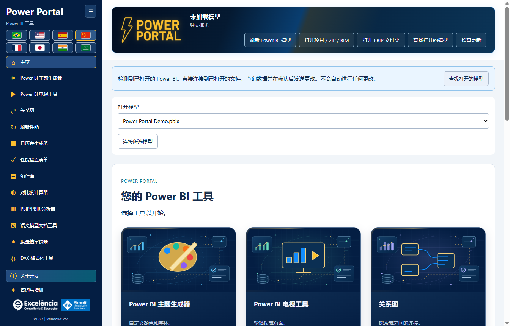

# 安装指南

<!-- language-selector -->
[🇺🇸 English](../INSTALLATION.md) · [🇧🇷 Português](../pt-BR/INSTALLATION.md) · [🇪🇸 Español](../es/INSTALLATION.md) · [🇨🇳 简体中文](INSTALLATION.md) · [🇫🇷 Français](../fr/INSTALLATION.md) · [🇯🇵 日本語](../ja/INSTALLATION.md) · [🇮🇳 हिन्दी](../hi/INSTALLATION.md) · [🇸🇦 العربية](../ar/INSTALLATION.md)
<!-- /language-selector -->

[返回主页](../../README.zh-CN.md)

<a name="requirements"></a>
## 系统要求

Windows 10/11 x64、管理员安装权限，以及支持外部工具的 Power BI Desktop 版本。应用以自包含的 Windows 安装程序分发。最终用户无需 PHP、Node.js、.NET SDK、Git 或 GitHub 帐户。

请预留约 1 GB 可用磁盘空间用于下载和安装运行时文件，并为自己的导出文件和备份留出额外空间。

<a name="simple-installation"></a>
## 简单安装

1. 打开[最新 Release](https://github.com/luisgnserra/powerportaldesktop/releases/latest)。
2. 在 **Assets（发布附件）**中下载本版本的 `PowerPortal-Setup-1.8.7-x64.exe`。不要将自动生成的源代码归档当作安装程序下载。
3. 可选择[验证 SHA-256](#verify-the-installer)。
4. 运行可执行文件并批准用户帐户控制提示。
5. 接受显示的依赖项条款，选择文件夹，并使用旗帜选择默认语言。安装程序会建议 Windows 界面语言；不支持的语言默认使用英语。
6. 完成向导。
7. 关闭并重新打开 Power BI Desktop。打开 PBIX，选择**外部工具 > Power Portal**。

安装对整台计算机生效，包括桌面/开始菜单快捷方式及外部工具注册。应用在正常使用时无需提权。


打开 PBIX 后点击**外部工具 > Power Portal**。截图中的 **Ferramentas externas** 是葡萄牙语功能区标签。该图标启动**独立的配套窗口**，并传递已打开文件的本地模型连接；它不是嵌入式视觉对象或内部报表窗格。



改为从 Windows 快捷方式启动时，检测到已打开的模型会显示提示。选择**查找已打开的模型**，核对文件名并连接。仅检测或连接不会作出任何更改。[查看图解操作指南](SCREENSHOTS.md)。

**未签名版本：**Windows 可能显示 SmartScreen 或未知发布者警告。SHA-256 用于确认您获取的是已发布文件，并非发布者的数字签名。不要绕过企业限制。如需批准，请咨询 IT 部门。

<a name="command-line-installation"></a>
## 命令行安装

<a name="download-the-helper-and-review-it"></a>
### 下载并审查辅助脚本

```powershell
$script = Join-Path $env:TEMP 'Install-PowerPortal.ps1'
[Net.ServicePointManager]::SecurityProtocol = [Net.ServicePointManager]::SecurityProtocol -bor [Net.SecurityProtocolType]::Tls12
Invoke-WebRequest -UseBasicParsing 'https://raw.githubusercontent.com/luisgnserra/powerportaldesktop/v1.8.7/install.ps1' -OutFile $script
Get-Content -LiteralPath $script
& $script
```

此带版本的 URL 将辅助脚本固定到 1.8.7，不会悄悄跟随未来版本。脚本还固定了安装程序文件名及 SHA-256 校验和，通过 HTTPS 下载，在运行前验证可执行文件，并在安装程序成功退出后检查安装注册。

TLS 这一行针对较旧的 Windows PowerShell 默认配置，在当前 PowerShell 进程中启用 HTTPS TLS 1.2。它不会更改 Windows 安全策略或执行策略。

<a name="unattended-installation"></a>
### 无人值守安装

**以管理员身份**打开 PowerShell，然后运行：

```powershell
& "$env:TEMP\Install-PowerPortal.ps1" -Silent
```

脚本下载并验证同一个安装程序，然后调用其 NSIS `/S` 开关。静默模式不显示向导的语言页面：安装程序使用 Windows 界面语言，不支持时回退到英语。用户已保存的偏好仍然优先。辅助脚本不会打开或编辑任何 PBIX。

静默模式要求 PowerShell 会话已经提权。它不会绕过 UAC、Windows 安全控件、脚本执行策略或应用限制。部署前请关闭 Power Portal；参阅[更新](#updates-and-downgrades)。

<a name="download-only-or-choose-a-download-folder"></a>
### 仅下载或选择下载文件夹

```powershell
& "$env:TEMP\Install-PowerPortal.ps1" -DownloadOnly -DownloadDirectory "$env:USERPROFILE\Downloads\PowerPortal"
```

`-DownloadOnly` 验证校验和但绝不执行安装程序，也无需管理员权限。之前下载的文件只有在校验和匹配时才会复用。无效的现有文件会导致明确错误，而不会被执行或悄悄覆盖。

辅助脚本参数：

| 参数 | 默认值 | 用途 |
|---|---|---|
| `-Silent` | 关闭 | 使用 NSIS 无人值守安装开关；除仅下载模式外，需要管理员 PowerShell。 |
| `-DownloadOnly` | 关闭 | 下载/缓存并验证可执行文件，不安装。 |
| `-DownloadDirectory` | `%TEMP%\PowerPortalDownloads` | 已验证安装程序的存放文件夹，不是应用安装目录。 |

不要将未经审查的脚本粘贴到 `Invoke-Expression` 中。如果执行策略阻止已下载的脚本，请咨询 IT 或使用可执行文件向导。辅助脚本有意不更改执行策略。

<a name="use-the-verified-executable-directly"></a>
### 直接使用已验证的可执行文件

验证校验和后，管理员可以运行：

```powershell
$setup = "$env:USERPROFILE\Downloads\PowerPortal-Setup-1.8.7-x64.exe"
$process = Start-Process -FilePath $setup -ArgumentList '/S' -Wait -PassThru
if ($process.ExitCode -ne 0) { throw "Installer failed: $($process.ExitCode)" }
```

推荐使用 PowerShell 辅助脚本，因为它同时检查下载文件及安装后的外部工具注册。

<a name="verify-the-installer"></a>
## 验证安装程序

**1.8.5 x64** 的预期 SHA-256：

```text
1137B13548FAC555A425CBF9D5E9E2FB94A829981EA3E5A4BF231F3AEF69F5AC
```

```powershell
$file = "$env:USERPROFILE\Downloads\PowerPortal-Setup-1.8.7-x64.exe"
$expected = '1137B13548FAC555A425CBF9D5E9E2FB94A829981EA3E5A4BF231F3AEF69F5AC'
if ((Get-FileHash -LiteralPath $file -Algorithm SHA256).Hash -ne $expected) {
    throw 'Checksum mismatch. Do not run this installer.'
}
```

校验和还发布在 [SHA256SUMS.txt](../../SHA256SUMS.txt) 中，并作为 Release 附件提供。校验和用于完整性检查，不能替代对发布者的信任。

<a name="updates-and-downgrades"></a>
## 更新与降级

下载较新的官方安装程序，并覆盖现有安装运行。在替换文件前，安装程序仅尝试关闭其确切目标可执行路径对应的 Power Portal，不会关闭 Power BI Desktop 或其他外部工具。如果关闭失败，安装会中止。

无人值守更新前请自行关闭 Power Portal。安装后重启 Power BI Desktop，以重新加载外部工具注册。现有的每用户语言/侧栏偏好及本地备份会保留。

从 **1.6.2** 起，启动检查及**检查更新**会通知较新的官方版本。**立即更新**仅在您点击后才下载安装程序并验证，然后在当前安装文件夹中启动提权的静默更新。Power BI 不会关闭。安装完成后重新打开 Power Portal。[更新详情](UPDATES.md)。

**1.6.1 及更早版本需要先手动升级一次到 1.6.2**。降级未经认证；使用旧安装程序前，请保存工作并联系支持。

<a name="uninstall"></a>
## 卸载

使用 **Windows 设置 > 应用 > 已安装的应用 > Power Portal > 卸载**（Windows 10 中使用**应用和功能**）。

卸载会删除应用及其自身的 `PowerPortal.pbitool.json` 注册，不影响其他工具。每用户设置、主题、备份及更改日志会有意保留。手动删除保留数据前，请参阅[数据位置](CONFIGURATION.md#data-locations)。

<a name="offline-and-enterprise-deployment"></a>
## 离线与企业部署

IT 可以下载并验证一次 Release 安装程序，通过获准的软件系统分发这一准确文件，并以管理员权限运行 `/S`。从公共 GitHub 下载需要互联网；从已经下载的可执行文件安装不需要 GitHub 身份验证。

本仓库不提供 Microsoft Store 软件包、MSI、winget 目录条目或 Chocolatey 软件包。支持的分发形式是 NSIS EXE 及其 PowerShell 辅助脚本。

[配置](CONFIGURATION.md) · [故障排除](TROUBLESHOOTING.md)
