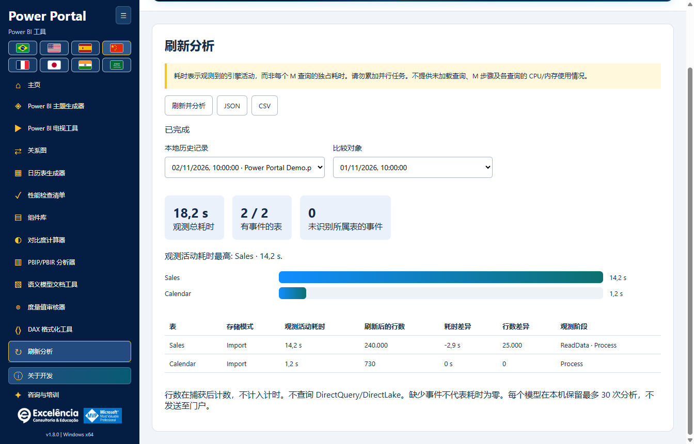

# 刷新分析

<!-- language-selector -->
[🇺🇸 English](../REFRESH-ANALYSIS.md) · [🇧🇷 Português](../pt-BR/REFRESH-ANALYSIS.md) · [🇪🇸 Español](../es/REFRESH-ANALYSIS.md) · [🇨🇳 简体中文](REFRESH-ANALYSIS.md) · [🇫🇷 Français](../fr/REFRESH-ANALYSIS.md) · [🇯🇵 日本語](../ja/REFRESH-ANALYSIS.md) · [🇮🇳 हिन्दी](../hi/REFRESH-ANALYSIS.md) · [🇸🇦 العربية](../ar/REFRESH-ANALYSIS.md)
<!-- /language-selector -->

## 开始与安全

连接正确的 PBIX，打开刷新分析并选择刷新并分析，确认文件名。跟踪先于调用原生“主页 > 刷新”按钮启动，不会通过 TOM 逐表刷新。保持 Power BI 打开，并在其中处理凭据、错误或取消操作。BIM 备份无法还原已刷新的数据。

原生刷新会查询数据源并替换导入的数据。请保存 PBIX 副本。在 Power BI 中处理凭据和错误；跟踪不会取消刷新，也不包含所有 Power Query 辅助查询。

## 解读测量结果

观测活动耗时是准确映射到每个表的引擎时间区间的并集，避免重复计算嵌套阶段。它不是纯数据源查询时间，也不能证明关键路径。观测总耗时从调用到检测完成，包括界面和轮询开销，不含之后的行数统计。未识别所属表的事件单独报告。

耗时表示观测到的引擎活动，而非每个 M 查询的独占耗时。请勿累加并行任务。不提供未加载查询、M 步骤及各查询的 CPU/内存使用情况。

自动完成需要观测到刷新命令结束且 Power BI 窗口就绪。请关闭原生结果对话框。手动结束捕获始终标记为不完整，不能证明成功，也不会取消刷新。引擎和跟踪错误会明确显示。中断的捕获不会被标记为已完成。

## 历史记录与导出

行数在捕获后计数，不计入计时。不查询 DirectQuery/DirectLake。缺少事件不代表耗时为零。每个模型在本机保留最多 30 次分析，不发送至门户。

选择已保存的执行及比较对象，按相同表名查看时间和行数差异。缓存、源负载、数据量及并行度会影响比较，差异不能证明原因。JSON 用 null 表示不可用值，CSV 留空并防止电子表格公式执行。历史记录保存在本机，使用与关系图相同的模型标识，不保存到 PBIX。标识完全相同的文件可能共用历史，请核对模型。导出包含名称及行数，共享前请审查。

<!-- refresh-correlation -->
仅测量通过精确 RequestID/ActivityID 与活动刷新命令相关联的引擎进度，排除无关的视觉对象查询。某些 Power BI 版本可能不提供这些标识：即使刷新已执行，表耗时仍可能不可用。
