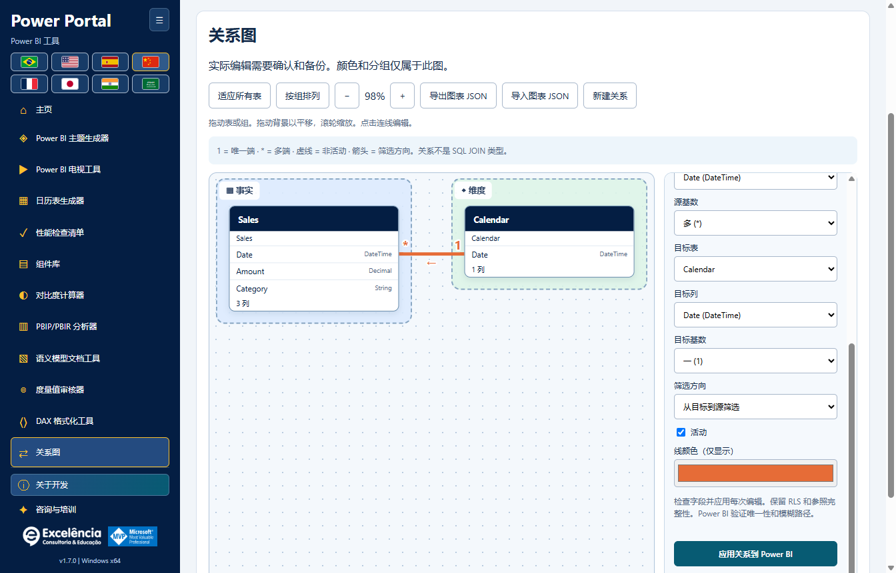
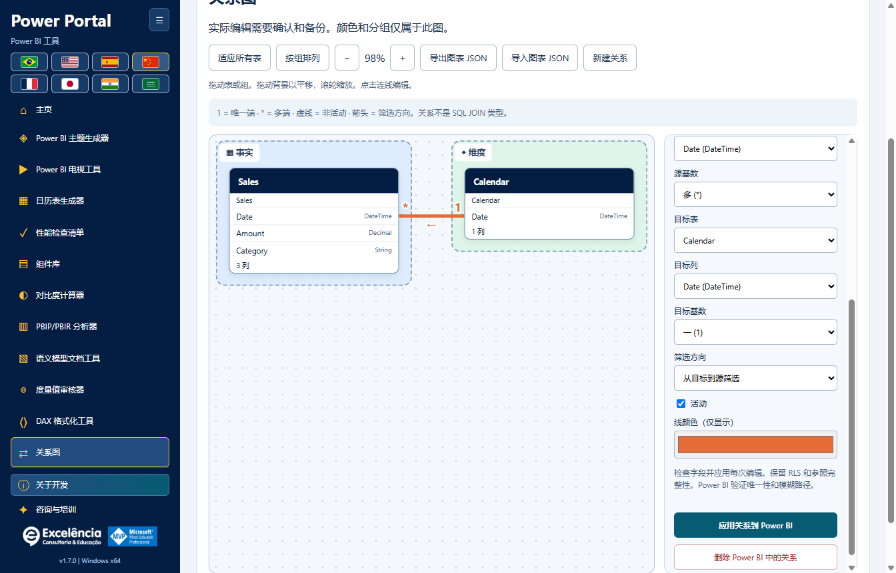

# 关系图

<!-- language-selector -->
[🇺🇸 English](../RELATIONSHIPS.md) · [🇧🇷 Português](../pt-BR/RELATIONSHIPS.md) · [🇪🇸 Español](../es/RELATIONSHIPS.md) · [🇨🇳 简体中文](RELATIONSHIPS.md) · [🇫🇷 Français](../fr/RELATIONSHIPS.md) · [🇯🇵 日本語](../ja/RELATIONSHIPS.md) · [🇮🇳 हिन्दी](../hi/RELATIONSHIPS.md) · [🇸🇦 العربية](../ar/RELATIONSHIPS.md)
<!-- /language-selector -->

[返回主页](../../README.zh-CN.md) · [截图](SCREENSHOTS.md) · [模型安全](USAGE.md)

适用于 **Power Portal Desktop 1.7.0**。这是仅适用于 Desktop 的新工具，独立于 Power BI 自身的模型视图。它读取真实的表/列关系，并可在确认后将更改应用到已连接的本地语义模型。



<a name="open-your-model"></a>
## 打开模型

1. 保存独立的 PBIX 副本。
2. 从 Power BI Desktop 启动**外部工具 > Power Portal**，或明确查找并选择已打开文件。
3. 从侧栏或主页图库打开**关系图**。

导入的 BIM/PBIP/TMDL 项目支持关系图及视觉自定义，但**关系写入需要实时的本地 Power BI 连接**。在其他地方更改后，请重新读取模型。

<a name="understand-the-links"></a>
## 理解关系线

- 每个框代表一张实际的表。原始表名仍显示在友好标题下方。
- 参与关系的列会优先显示在框内。最多显示八列及其数据类型；关系编辑器仍可选择全部列。
- **1** 表示唯一的一端；**\*** 表示多的一端。
- 实线为活动关系；虚线为非活动关系。
- 箭头表示筛选传播：单向 TOM 筛选方向是**从目标表到源表**，而不是您选择列的顺序。双向关系显示两个方向。**?** 表示 Automatic，由引擎决定。
- 点击关系线或使用关系下拉列表，可检查准确端点、基数及筛选设置。
- 不支持的非单列关系会在模型元数据中明确计数，并在界面中警告。不会编造或编辑这些关系。

**这些是语义模型关系，不是 SQL INNER/LEFT/RIGHT JOIN 选项。**基数及筛选方向会影响报表计算和筛选传播。

<a name="arrange-a-teaching-friendly-diagram"></a>
## 布置便于教学的关系图

- 可在两个方向上自由拖动表标题。
- 拖动分组标题，可整体移动成员表。
- 拖动背景进行平移。滚动或使用 **+ / -** 缩放。
- **适配表**将当前模型纳入视野；新关系图初始时会自动适配。
- **按分组排列**依据分配的分组布局表。此操作只重排关系图，不改变模型。
- 将焦点移至表标题后，使用方向键移动 10 个单位；Shift + 方向键移动 50 个单位。
- 选择表以设置友好名称、图标、背景颜色及分组。
- **Facts** 和 **Dimensions** 是可选的起始分组，并非自动判定表角色。
- 创建自定义分组后，可编辑名称、图标及背景颜色。删除分组不会删除其中的表。
- 选择现有关系可设置线条颜色。

**颜色、位置、分组、图标及友好名称不会重命名 Power BI 对象，也不会改变其原生模型视图布局。**它们属于此配套关系图。

<a name="save-and-share-the-organization"></a>
## 保存与共享组织布局

视觉更改自动保存在当前 Windows 用户的配置目录中：

```text
%APPDATA%\powerportal-desktop\relationship-diagrams\<model-key>.json
```

写入使用中间文件及原子替换。失败时会明确显示，并提供**重试保存**；应用不会假装布局已保存。

**导出关系图 JSON**创建可移植的视觉布局文件。**导入关系图 JSON**验证格式，并检查其中的表名是否存在于当前加载的模型中。它仅恢复组织布局：**导入关系图绝不会创建、更改或删除模型关系**。

JSON 包含表名、友好名称、分组设置、线条颜色及视口，不含数据行、DAX 或数据源连接凭据。表/分组名称仍可能透露业务背景；请仅共享脱敏文件。

实时模型配置使用 Power BI 窗口/文件名及表沿袭标记识别，缺失时回退到表名。导入项目的配置还使用所选本地路径。Power BI 发现机制无法可靠提供完整 PBIX 路径。重命名文件或替换表标识可能产生新配置；同名且沿袭标记相同的副本可能共用配置。必要时使用导出 JSON 维护独立布局。

刷新元数据时会移除过期表/线条条目。已删除表的旧位置不会作为虚构表保留。卸载时，布局与其他用户设置一同保留。

<a name="apply-each-relationship-edit-to-power-bi"></a>
## 将每次关系编辑应用到 Power BI



<a name="create"></a>
### 创建

1. 选择**新建关系**。
2. 选择源/目标表及列。
3. 设置基数、筛选方向及活动/非活动状态。
4. 选择**将关系应用到 Power BI**。

<a name="edit-activate-or-deactivate"></a>
### 编辑、激活或停用

1. 点击现有关系线，或在下拉列表中选择它。
2. 更改端点、基数、筛选方向或**活动**状态。
3. 为此次编辑选择**将关系应用到 Power BI**。

<a name="delete"></a>
### 删除

选择现有关系，然后选择**在 Power BI 中删除关系**。

每次真实编辑都使用相同的安全顺序：

1. 原生确认会标明所选 Power BI 文件，并显示关系之前/之后的状态。**默认为取消**。
2. 批准后，必须先写入完整元数据 BIM 备份及本地尝试记录，再更改模型。
3. 连接器重新打开模型，并验证现有关系仍与编辑器读取的快照一致。过期/已删除/已重命名关系会被拒绝，而非被覆盖。
4. 列的数据类型必须匹配，且属于不同表。重复列对及同一表对之间第二条直接活动关系会被拒绝。请先停用现有活动关系。
5. TOM 通过 `SaveChanges` 提交；唯一性、有效基数及歧义筛选路径仍由引擎验证。引擎错误会显示，不会被绕过。
6. 成功提交后，应用重新加载模型元数据。重新加载失败会报告为已写入的更改，而非取消。
7. **在 Power BI Desktop 中保存 PBIX**，以将更改后的模型持久化到文件。

现有关系的行级安全筛选行为、**假定引用完整性（Assume Referential Integrity）**及其他未公开设置会保留。此编辑器不提供更改 RLS 或启用 Assume Referential Integrity 的方式。新关系使用默认安全/完整性设置。

保留这些属性并不意味着激活、删除或端点更改不会影响安全筛选传播。确认更改前，请与模型管理员审查 RLS 使用的关系。

更新/主题/模型写入不能与关系写入并发运行。写入期间禁止切换连接模型；来自不同所选连接的请求会被拒绝。

<a name="backup-and-limits"></a>
## 备份与限制

- BIM 备份包含模型元数据，不是完整 PBIX、报表画布或全部数据行。成功写入或连接器失败后会报告其路径。
- **没有自动关系回滚/完整模型恢复按钮。**请保留独立 PBIX 副本，必要时与模型管理员审查报告的备份。
- 关系图 JSON 导入限制为 5 MB、2,000 个表条目、200 个分组及 10,000 个线条样式条目。缩放范围为 15% 至 200%。
- 工具不计算 SQL 联接、不合并查询、不自动分类事实表/维度表，也不执行任意脚本。
- 实时 Desktop 写入可能受模型模式、Desktop 版本、权限或企业政策限制。不要绕过这些限制。

[配置与保留数据](CONFIGURATION.md#data-locations) · [故障排除](TROUBLESHOOTING.md)
