# 截图与 Power BI 交互

<!-- language-selector -->
[🇺🇸 English](../SCREENSHOTS.md) · [🇧🇷 Português](../pt-BR/SCREENSHOTS.md) · [🇪🇸 Español](../es/SCREENSHOTS.md) · [🇨🇳 简体中文](SCREENSHOTS.md) · [🇫🇷 Français](../fr/SCREENSHOTS.md) · [🇯🇵 日本語](../ja/SCREENSHOTS.md) · [🇮🇳 हिन्दी](../hi/SCREENSHOTS.md) · [🇸🇦 العربية](../ar/SCREENSHOTS.md)
<!-- /language-selector -->

**1.8.5 — 修复原生刷新测量**

刷新分析现可识别 Power BI Desktop 使用的原生 XML Refresh 命令，包括 Batch 内的 Refresh，并继续支持 XMLA Process 和 TMSL refresh。此前刷新可能已执行，但进度被当作无关事件丢弃，导致测量表数为 0、行数不可用及 refreshCompletionNotProven。可选 Error 字段缺失时，现接受引擎明确的成功结果；非零错误码和 XMLA 错误仍优先。进度仍须精确关联请求或活动，以排除无关视觉查询。

识别到第一个刷新命令前，界面会提示正在等待 Power BI 刷新事件。无法确认完成时，显示翻译后的说明而非仅技术代码。请更新应用，连接正确的 PBIX，再次运行刷新并分析；旧的不完整报告将保留，不会被改为成功。打包应用已通过用户授权的真实刷新端到端验证，覆盖表活动、行数、自动完成和重载后保留的历史记录。文档截图仍为合成示例，不含用户数据或模型名称。

**1.8.5 — 通过浏览器下载更新**

发现新版本时，更新通知现在会在立即更新旁提供在浏览器中下载。它使用默认浏览器打开检测到的官方 GitHub 安装程序地址，不会关闭 Power Portal 或开始安装。准备好后请手动运行下载的安装程序。自动更新出错后此选项仍然可用，浏览器启动失败会明确显示。立即更新仍会在应用内下载、验证 SHA-256 和大小，然后请求 Windows 授权。浏览器下载不会经过应用的自动校验：运行安装程序前请比较已发布的 SHA-256。两个按钮和提示均已翻译为八种语言。

**1.8.5 — 平滑的主题预览**

主题生成器的折线图现使用平滑三次曲线代替直线段，适用于示例数据和已连接模型的数据。曲线经过原始数据点，不会在数值之间产生额外峰值，并保留颜色、标记和提示。此更改仅影响预览：导出的主题 JSON 和现有 Power BI 视觉对象的线条格式保持不变。

**1.8.5 — 刷新启动修复**

刷新分析现位于侧边菜单和首页图库中关系图的正下方。原生按钮查找会忽略 DAX 查询视图和 TMDL 视图中重复的 Home 选项卡，避免“Ambiguous Power BI control: home”错误。如果找不到控件，请在 Power BI 中选择报表、数据或模型视图。

[返回主页](../../README.zh-CN.md) · [安装](INSTALLATION.md) · [安全指南](USAGE.md)

**应用截图：Power Portal Desktop 1.8.5，所选界面语言为简体中文。**
截图使用**合成演示元数据及查询值**，而非客户 PBIX。连接状态演示受支持的界面操作；制作这些图片时未更改任何客户模型。原生文件选择器标签可能遵循 Windows 语言。真实的 Power BI 功能区截图由所有者提供，保留葡萄牙语原始界面，并已裁去私有文件标题。

关系箭头现在直接位于曲线上，并按曲线局部方向旋转，包括对角线和反向连接。 更大的 SVG 箭头为 36 × 26 单位，始终为黑色并带有 3 单位白色轮廓，不受关系线颜色影响。 单向筛选仍从目标表传播到源表；双向筛选显示两个相反箭头。自动筛选保留问号标记。此更新仅更改显示效果。

Power Portal 动画页眉现已包含文件名、连接状态以及五个读取、导入、查找和更新按钮。已移除横幅下方的独立工具栏，以释放工作空间。在较小窗口和全部八种语言（包括阿拉伯语）中，内容会在页眉内自动换行。连接确认、通知和更新行为保持不变。

## 在 Power BI 中创建真实关系

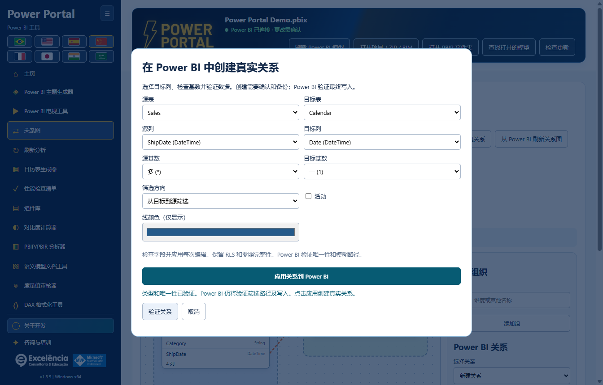

关系图现在紧接在侧栏和主页图库中的 TV Tool 之后。 日历生成器和组件库不再显示通用的真实模型数据块。工具自身的读取和写入控件保持可用；真实日期范围按钮使用工具内所选的日历表。 主页封面已重新绘制为不含内嵌文字的本地矢量插图。标题、说明和操作位于图片之外，并随所选语言切换。 将源列拖到另一张表即可打开真实关系对话框并选择目标列。放到列上会预选该列。检查基数、筛选方向和活动状态，再验证并应用；写入需要原生确认和 BIM 备份。

验证检查类型、重复列对、现有活动连接，以及两列的实际行数和不同值数量，而不是抽样。一端的重复值会被拒绝。查询超时为 20 秒，失败会明确显示。验证不会写入。应用时会再次验证，最终提交由引擎检查键和筛选路径歧义。虚线草稿不代表已保存关系，只有成功确认写入后才会创建。之后请保存 PBIX。测试和截图均使用合成数据，未修改客户 PBIX。

## 如何使用分组整理

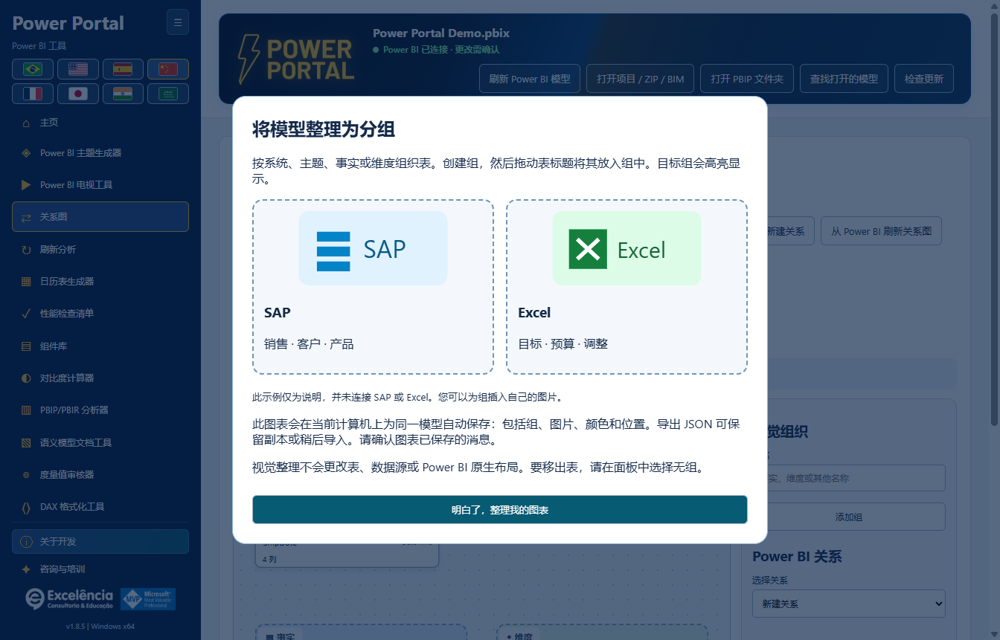

每次启动应用后首次打开图表时会显示分组介绍。点击**如何使用分组整理**可重新打开。SAP 和 Excel 仅为系统示例，不是新增连接器或官方徽标。空组显示为放置区域。放入高亮组会分配表；在组外松开则保留当前分组。

按系统、主题、事实或维度组织表。创建组，然后拖动表标题将其放入组中。目标组会高亮显示。

此图表会在当前计算机上为同一模型自动保存：包括组、图片、颜色和位置。导出 JSON 可保留副本或稍后导入。请确认图表已保存的消息。

视觉整理不会更改表、数据源或 Power BI 原生布局。要移出表，请在面板中选择无组。

## 从外部工具打开 Power Portal

安装后，重启 Power BI Desktop，打开 PBIX，然后点击**外部工具 > Power Portal**。

葡萄牙语选项卡 **Ferramentas externas** 对应英语的 **External Tools**（外部工具）。安装程序在此功能区注册图标。点击后会启动**连接到已打开文件模型的独立 Power Portal 窗口**。它是外部配套应用，不是报表视觉对象、嵌入式窗格或 Microsoft 内部扩展。

## 主页与导航

关系图现在紧接在侧栏和主页图库中的 TV Tool 之后。 主页封面已重新绘制为不含内嵌文字的本地矢量插图。标题、说明和操作位于图片之外，并随所选语言切换。

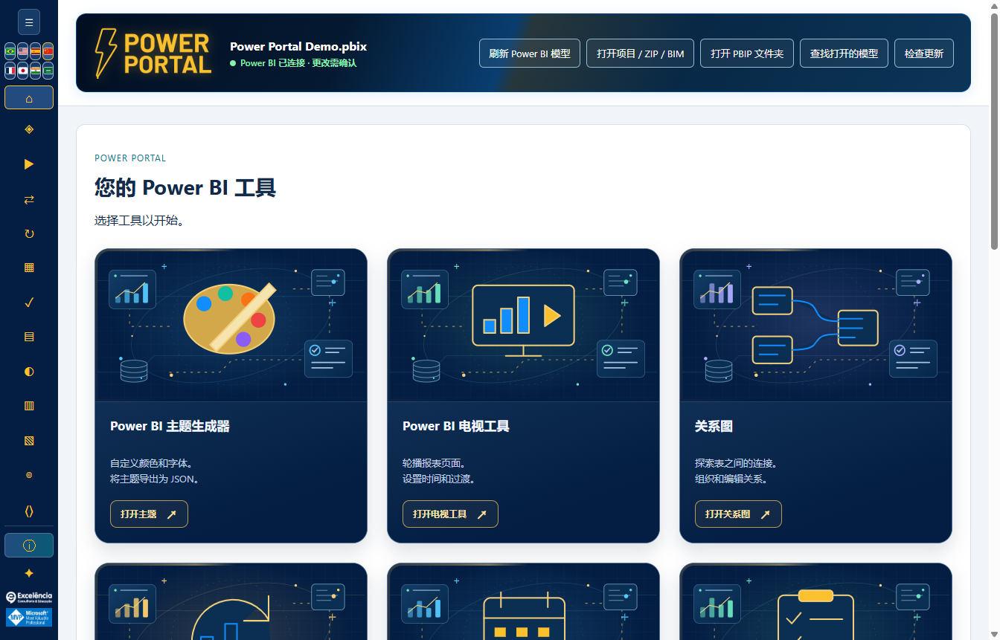

折叠侧栏可获得更多工作空间，偏好会保存。图标保留无障碍名称及工具提示。主工作区和各工具表单仍可滚动；无需滚动的变化仅适用于侧栏目录。

## 连接到已在 Power BI 中打开的文件

从 Windows 快捷方式启动时，应用检测可用的本地 Power BI 模型，并说明可直接连接到已打开文件。选择**查找已打开的模型**，核对文件名，再点击**连接到所选模型**。多个文件打开时，请明确选择目标。

从外部工具功能区启动则自动传递对应 Desktop 实例的连接，并读取元数据。**连接不会写入更改。**

## 新版本通知

截图使用**合成的未来 1.8.5 结果**，展示 1.8.5 中的通知，并非声称 1.8.5 已发布。使用 1.6.2 或更新版本的用户现在可以收到真实的 1.8.5 通知。

在 1.6.4 中，琥珀色横幅在滚动时仍可见，并会轻柔地动画显示，除非启用了减少动态效果。不再持续显示占用空间的“已是最新版本”横幅。

已安装应用启动时检查最新稳定官方 Release。点击**立即更新**下载并验证安装程序，然后批准 Windows 管理员请求。它更新现有安装文件夹，且只关闭 Power Portal。**仅连接或检查绝不会安装任何内容。**请先保存/导出未发送的工具编辑，安装完成后重新打开应用。

**检查更新**可随时重试检查。离线/速率限制/校验和/UAC 失败会明确显示，不会禁用本地工具。[完整更新指南](UPDATES.md)。

## 与已打开 Power BI 文件直接交互

这些功能不仅限于下载文本或 JSON：

| 界面/操作 | 读取或更改 Power BI？ | 保护措施 |
|---|---|---|
| 刷新 Power BI 模型 | 读取所选文件语义模型中的表、列、度量值及关系。 | 不写入模型。 |
| 查询实时数据/日期范围/样本 | 通过本地引擎读取真实模型值。 | 结构化、有边界限制的查询；不是当前页面筛选。 |
| 将主题直接发送到 Power BI | 将生成的 JSON 应用到所选报表窗口。 | 确认、可见界面导入及导出主题验证。 |
| 在 Power BI 中创建日历 | 在语义模型中创建新的计算日期表。 | 确认及元数据备份；之后在 Desktop 中刷新。 |
| 在 Power BI 中创建 HTML 度量值 | 在所选模型表中创建新度量值。 | 确认及元数据备份；手动添加 HTML 视觉对象。 |
| 在 Power BI 中更新度量值 | 将格式化的 DAX 写入选中的现有度量值。 | 确认、元数据备份及并发更改保护。 |
| 在 Power BI 中应用/删除关系 | 创建、编辑、激活/停用或删除所选列关系。 | 原生确认、元数据备份、过期状态检查及引擎验证；保留 RLS/完整性设置。 |

**应用更改前请保存独立 PBIX 副本。**确认目标文件及表达式，然后在 Desktop 中保存 PBIX。应用绝不会悄悄保存 PBIX。

### 实时模型数据

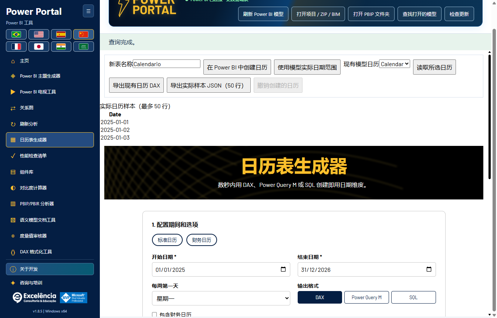

样本仍限制为 50 行，查询超时为 20 秒。日历数据通过工具自身的选择器和预览读取；日历生成器和组件库不再显示通用数据块。连接状态保留在页眉中。

### 主题生成器

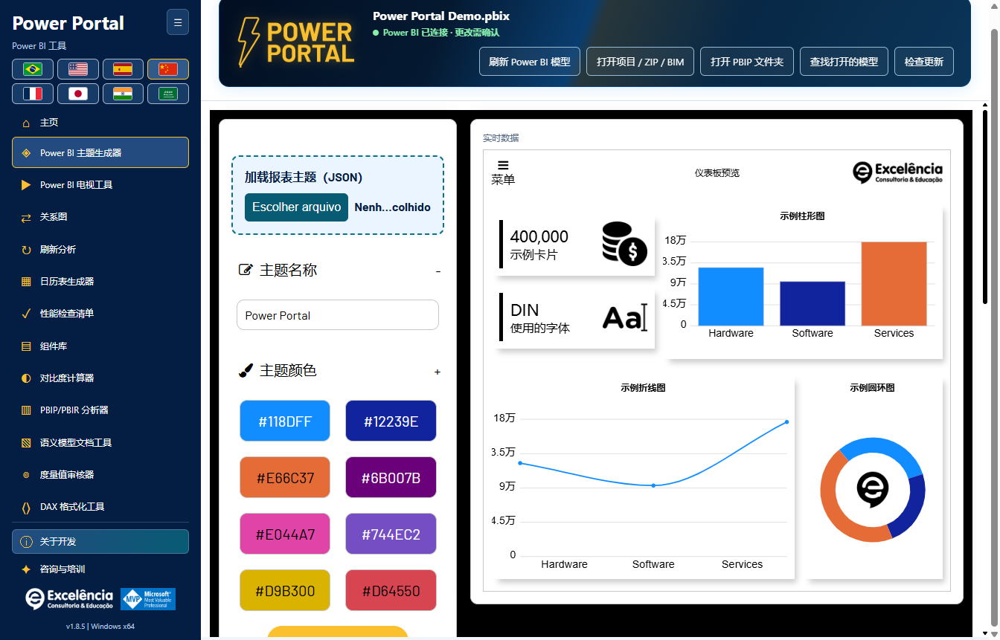

使用醒目的**加载报表主题（JSON）**区域，编辑颜色/字体并观察实时预览。导出 JSON，或滚动到页面末尾、表单和预览下方，使用**将主题直接发送到 Power BI**。

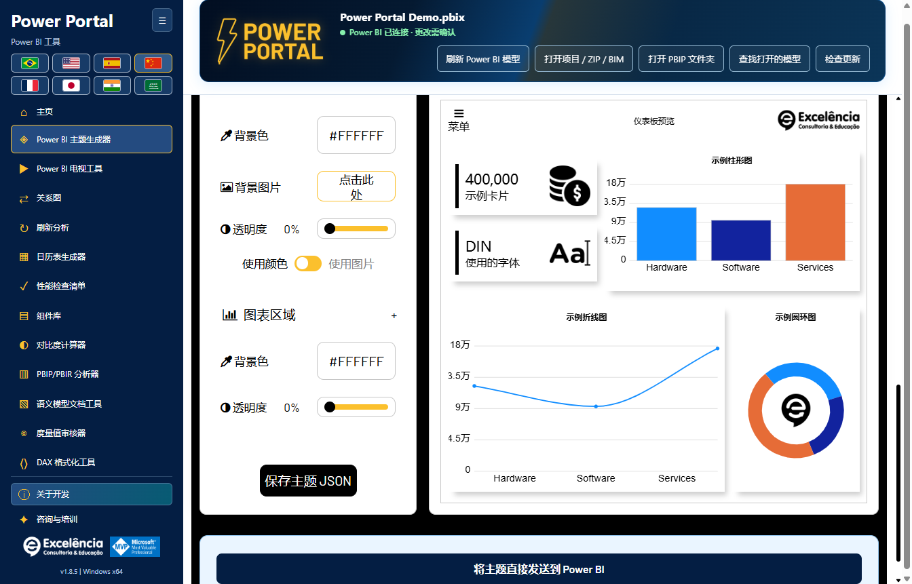

若要以现有报表主题为起点，请在 Desktop 中保存 JSON 并在此加载。语义模型连接不读取报表主题。直接发送仍使用**可见导入对话框**：没有受支持的通用 Desktop 主题 API 能消除它。自动化期间不要与 Power BI 交互。

### 日历生成器

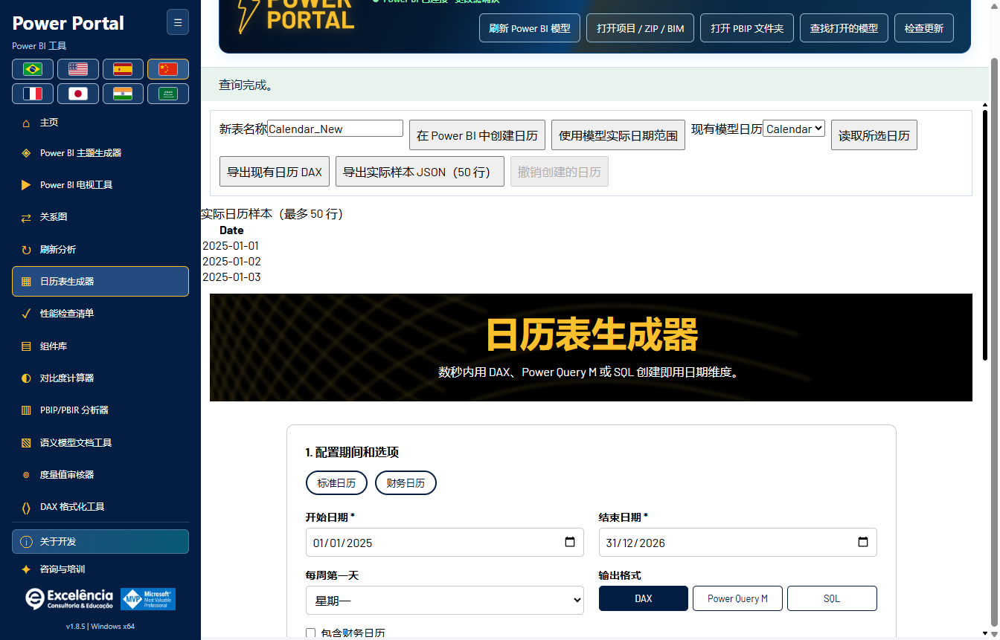

读取现有日历的表达式/日期范围/样本，导出 DAX 或样本 JSON，并生成新日历。**在 Power BI 中创建日历**会在备份和确认后创建新的计算表，而非替换选中的现有日历。

创建后在 Desktop 中刷新。只有创建的表仍匹配且无依赖项时，才能使用带保护的日历撤销。

### 组件库

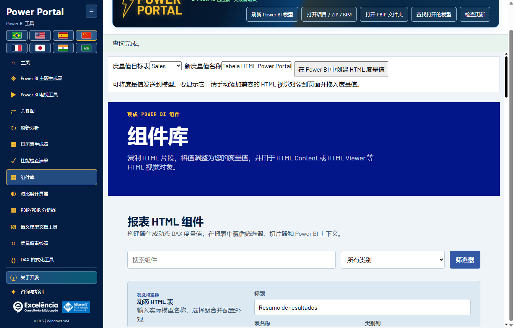

选择目标表和新度量值名称。构建器使用模型字段/度量值名称，并支持**在 Power BI 中创建 HTML 度量值**。确认后，度量值写入模型。

必须手动在报表中添加兼容的 HTML 视觉对象并分配该度量值；此按钮不会在页面上放置视觉对象。

### DAX 格式化器

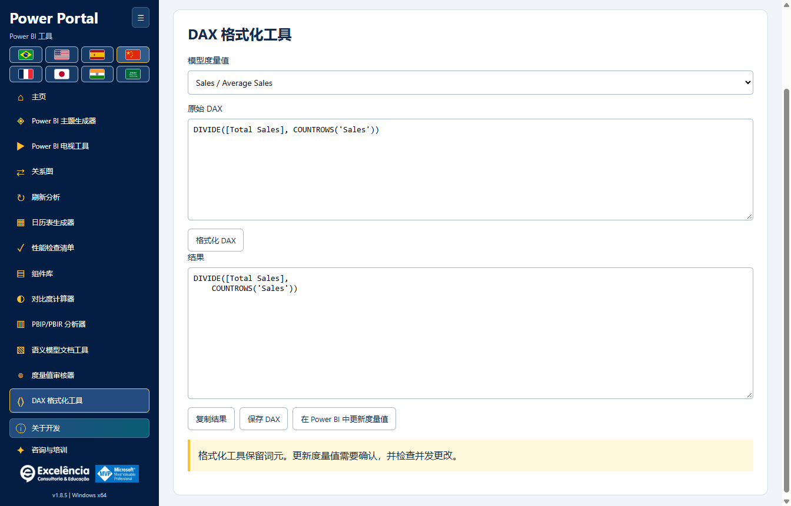

选择现有模型度量值，格式化表达式，然后选择**在 Power BI 中更新度量值**，将 DAX 提交回该度量值。复制/导出是独立操作。更新会拒绝并发的表达式更改，且需要确认。

## 其他工具

### 关系图

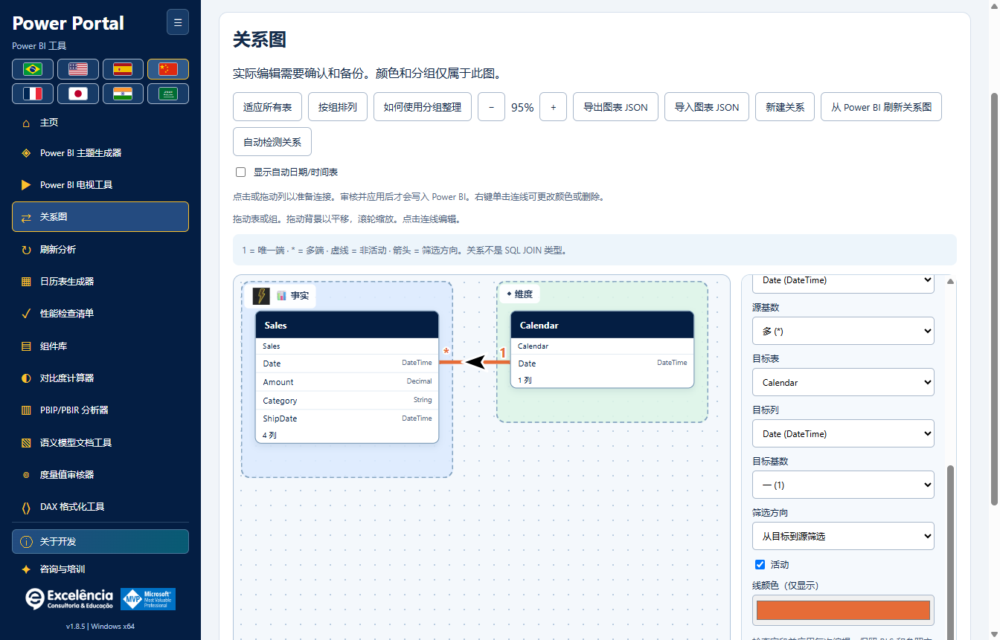

新的 Desktop 专用工具显示真实表关系、基数、筛选箭头及非活动虚线。可自由拖动表框/分组、缩放/平移、指定友好名称/图标，并自定义分组和线条颜色。视觉布局按模型自动保存，可导出/导入 JSON，不提交模型写入。

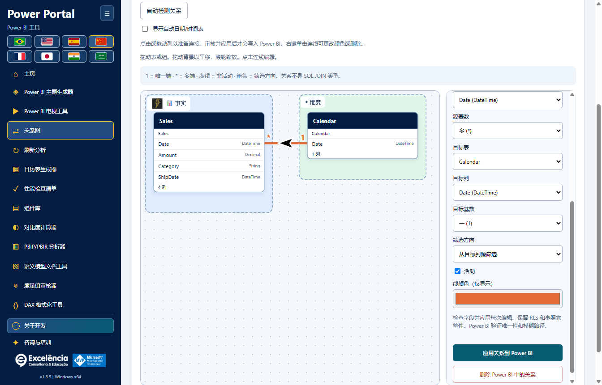

选择关系线，检查准确的列、基数、筛选方向及活动状态。**将关系应用到 Power BI**或**在 Power BI 中删除关系**会在原生确认和备份后提交每次编辑。导入项目仍为只读。样式不会重命名表或更改 Power BI 原生关系图。[完整操作指南及安全限制](RELATIONSHIPS.md)。

在 1.8.5 中，可点击或拖动列来准备虚线草稿，然后检查并应用。右键单击关系线可设置颜色、编辑或删除。分组设置支持本地 PNG/JPEG 图片及更多图标；可拖动分组背景或标题。自动日期/时间表默认隐藏。**从 Power BI 刷新关系图**会重新读取外部更改，但不会复制原生布局坐标。**自动检测关系**会在确认/备份后启动 Desktop 原生检测；请先检查并关闭其对话框，再选择**完成检测并刷新关系图**。

### Power BI TV Tool

顶部 **TV Tool 实际演示**横幅在默认浏览器中打开[可用的官方示例](https://www.powerportal.com.br/tv_tool/painel_exemplo_power_bi_tv_tool.html)，需要互联网，但不发送本地模型数据。表单中的本地演示仍然可用。

轮播已发布的报表页面或本地图片，设置时长/切换效果、预览并导出 HTML。TV **不会**轮播本地已打开 PBIX 的页面。私有已发布报表需要相应的 Microsoft 登录/许可证/权限。

### 性能检查清单

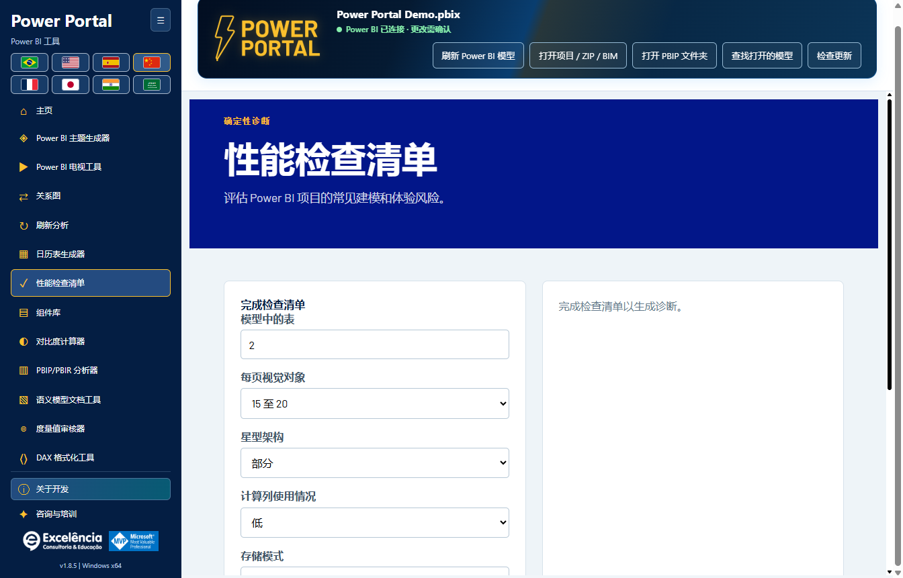

审查参考模型的检查项及手动填写的报表特征。评分是启发式指导，不是实测视觉对象耗时。

### 对比度计算器

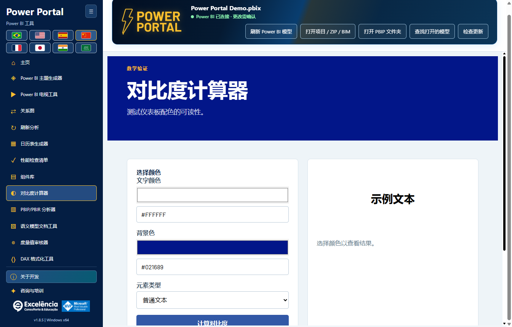

根据 WCAG 阈值检查可读性/对比度。这是本地分析工具，不会自动修改报表格式。

### PBIP/PBIR 分析器

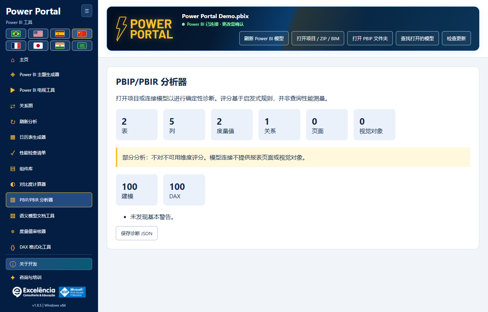

分析已加载项目的可用结构。实时语义模型连接不提供报表页面/视觉对象元数据，因此不可用维度会报告为不完整。导入的 PBIR 项目元数据可提供更多计数。

### 语义模型文档生成器

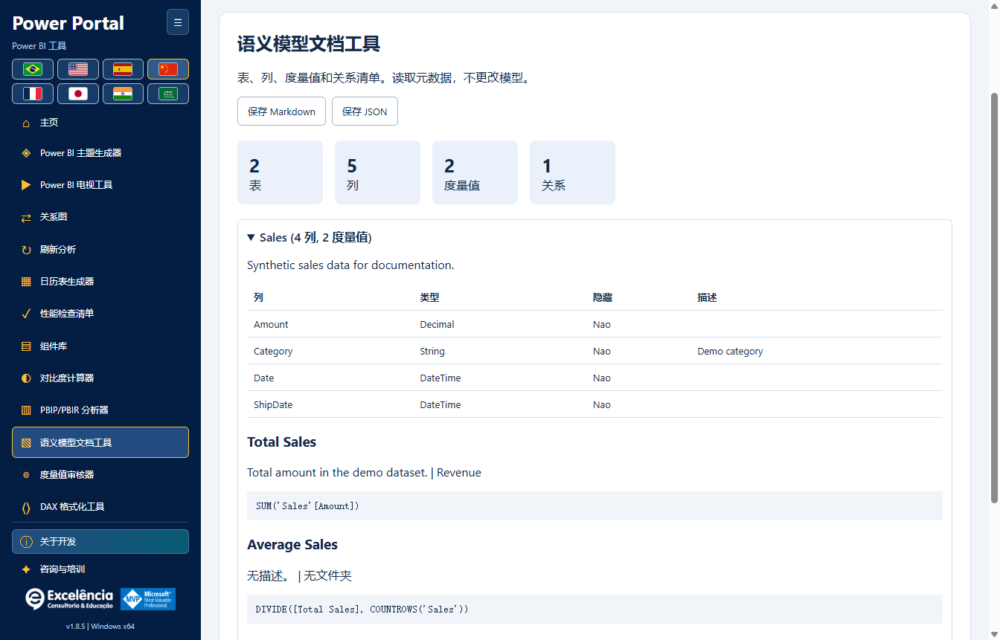

读取并以 Markdown 或 JSON 导出表/列/度量值/关系文档。此工具不修改模型。导出可能包含机密名称及 DAX，请妥善存储。

### 度量值审计器

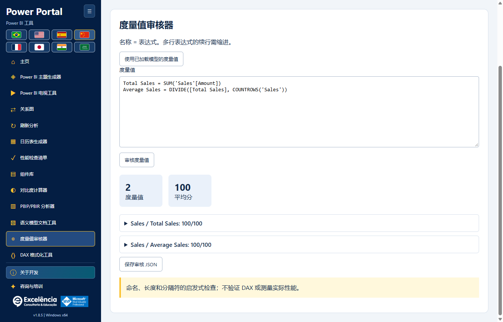

使用启发式命名/长度/分隔符检查审计模型度量值或提供的 DAX。它不验证 DAX 语义，也不测量实际报表性能。

## 咨询与培训

了解 Power BI 咨询、Microsoft Fabric、数据工程及完整解决方案。包含企业内训、精选视频及联系操作。WhatsApp/电子邮件会打开草稿或浏览器页面，不会自动发送消息或预约。

[版本说明](../../CHANGELOG.zh-CN.md) · [故障排除](TROUBLESHOOTING.md)

## 刷新分析

测量原生刷新。 比较耗时和行数。 [刷新分析](REFRESH-ANALYSIS.md).

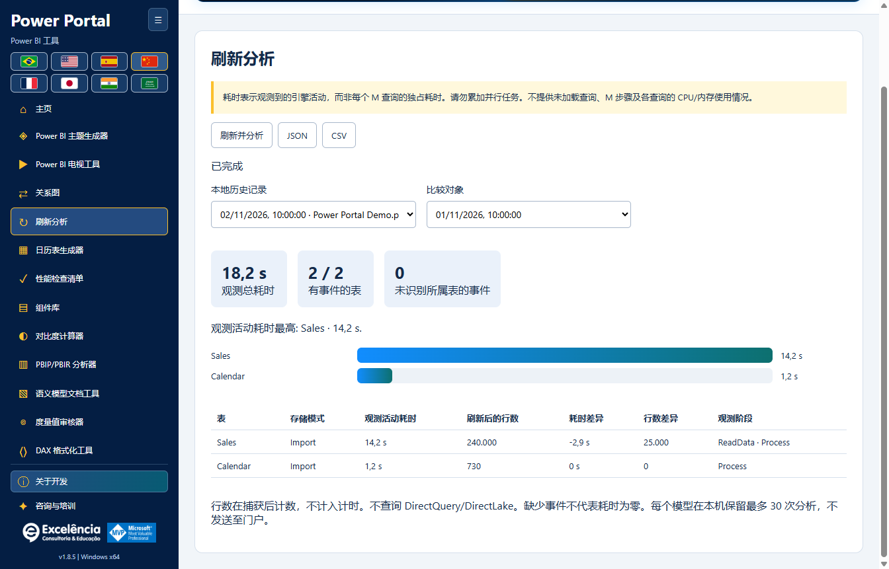

观测活动耗时是准确映射到每个表的引擎时间区间的并集，避免重复计算嵌套阶段。它不是纯数据源查询时间，也不能证明关键路径。观测总耗时从调用到检测完成，包括界面和轮询开销，不含之后的行数统计。未识别所属表的事件单独报告。

自动完成需要观测到刷新命令结束且 Power BI 窗口就绪。请关闭原生结果对话框。手动结束捕获始终标记为不完整，不能证明成功，也不会取消刷新。引擎和跟踪错误会明确显示。中断的捕获不会被标记为已完成。

## 动态主页卡片

十二张主页卡片采用与侧栏相同的海军蓝底色（#041e43），配以原创无文字矢量场景。每个工具保留专属中心插图，并增加数据面板、图表、数据库、轨道、网格和漂浮元素。信号线缓慢流动。封面不加载外部图片、脚本或服务。

鼠标悬停或键盘聚焦时，会显示金色边框和光晕、扫光、更明亮的插图、圆形打开箭头及金色操作按钮。按下时立即反馈，不延迟导航。Enter/空格仍打开同一工具。系统或浏览器的减少动态效果设置会停止动画，同时保留静态高亮和可见焦点。标题和操作文字位于图像外，随所选语言切换。截图展示普通和悬停静态状态，并非视频。

