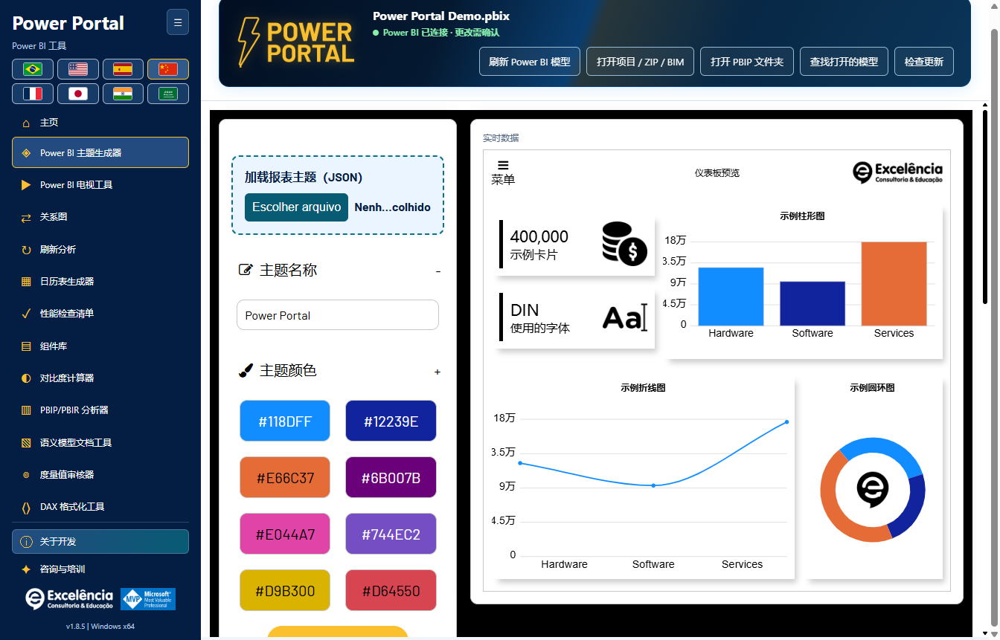
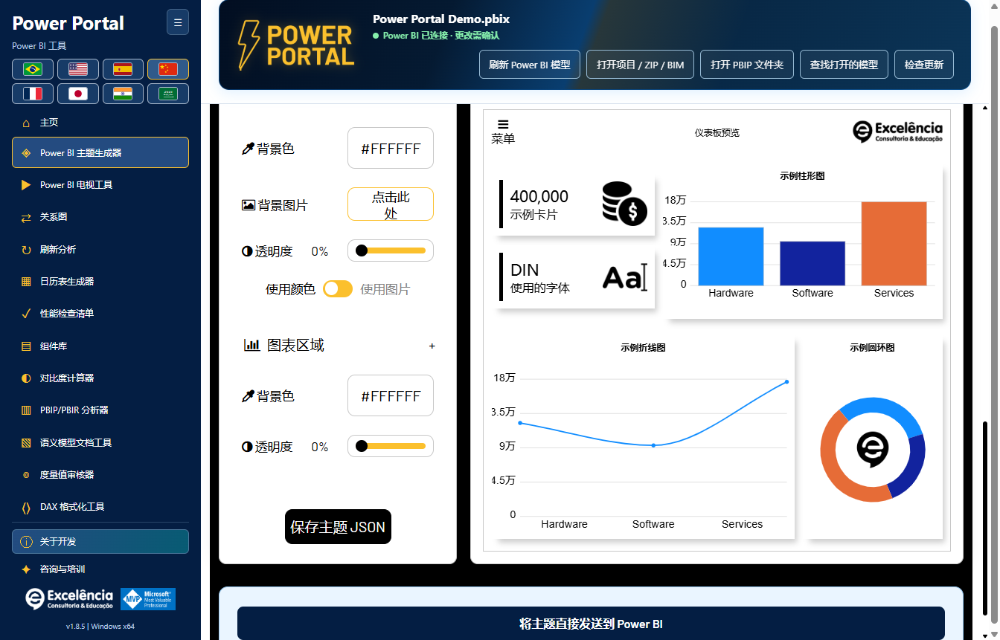
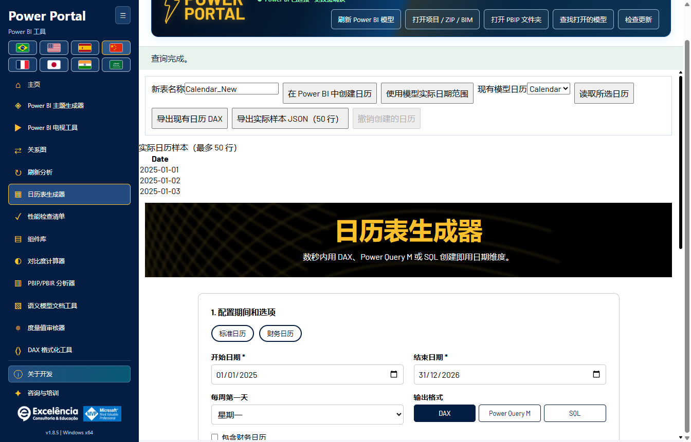
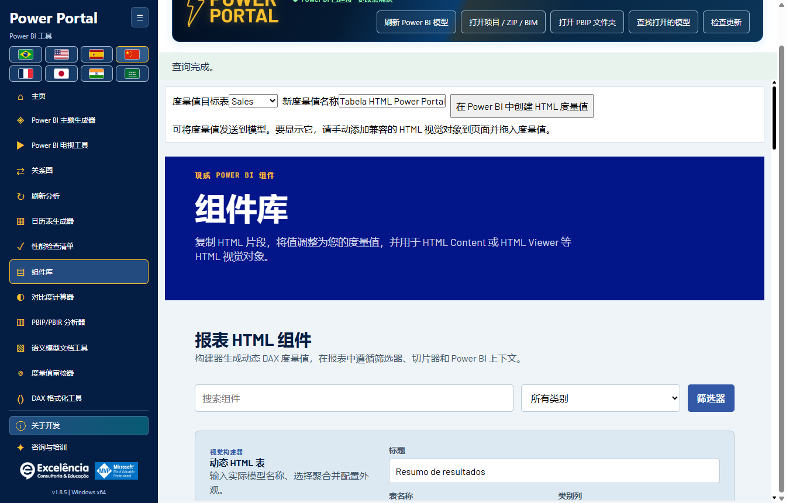
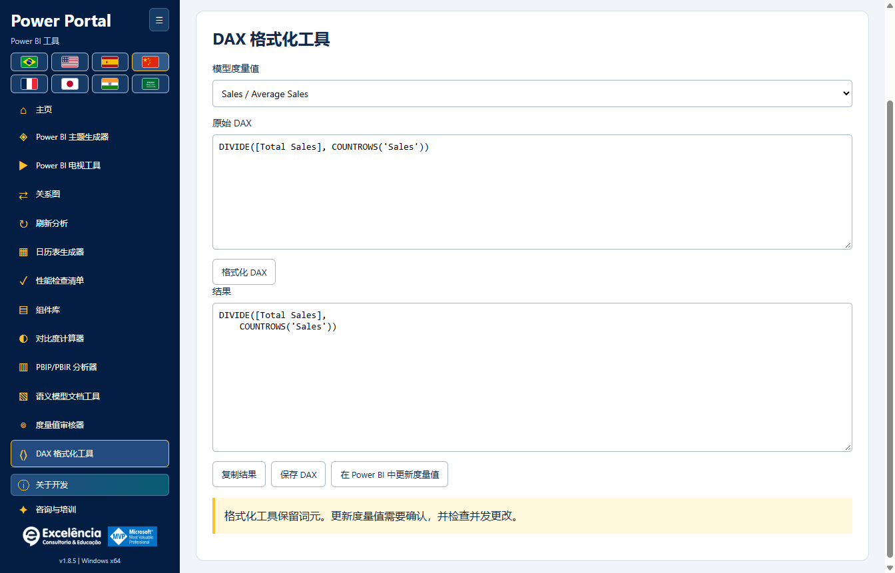
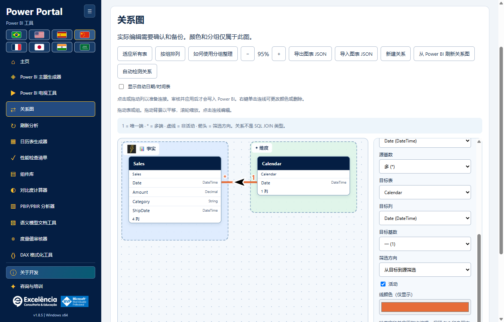
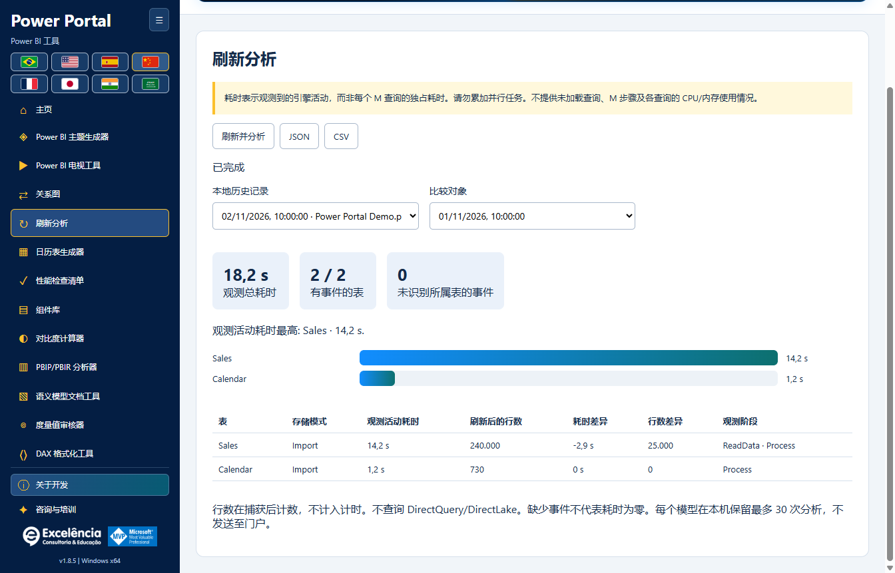

# 使用与模型安全

<!-- language-selector -->
[🇺🇸 English](../USAGE.md) · [🇧🇷 Português](../pt-BR/USAGE.md) · [🇪🇸 Español](../es/USAGE.md) · [🇨🇳 简体中文](USAGE.md) · [🇫🇷 Français](../fr/USAGE.md) · [🇯🇵 日本語](../ja/USAGE.md) · [🇮🇳 हिन्दी](../hi/USAGE.md) · [🇸🇦 العربية](../ar/USAGE.md)
<!-- /language-selector -->

**1.8.5 — 平滑的主题预览**

主题生成器的折线图现使用平滑三次曲线代替直线段，适用于示例数据和已连接模型的数据。曲线经过原始数据点，不会在数值之间产生额外峰值，并保留颜色、标记和提示。此更改仅影响预览：导出的主题 JSON 和现有 Power BI 视觉对象的线条格式保持不变。

[返回主页](../../README.zh-CN.md)

Power Portal 动画页眉现已包含文件名、连接状态以及五个读取、导入、查找和更新按钮。已移除横幅下方的独立工具栏，以释放工作空间。在较小窗口和全部八种语言（包括阿拉伯语）中，内容会在页眉内自动换行。连接确认、通知和更新行为保持不变。

关系图现在紧接在侧栏和主页图库中的 TV Tool 之后。 日历生成器和组件库不再显示通用的真实模型数据块。工具自身的读取和写入控件保持可用；真实日期范围按钮使用工具内所选的日历表。 主页封面已重新绘制为不含内嵌文字的本地矢量插图。标题、说明和操作位于图片之外，并随所选语言切换。 将源列拖到另一张表即可打开真实关系对话框并选择目标列。放到列上会预选该列。检查基数、筛选方向和活动状态，再验证并应用；写入需要原生确认和 BIM 备份。

验证检查类型、重复列对、现有活动连接，以及两列的实际行数和不同值数量，而不是抽样。一端的重复值会被拒绝。查询超时为 20 秒，失败会明确显示。验证不会写入。应用时会再次验证，最终提交由引擎检查键和筛选路径歧义。虚线草稿不代表已保存关系，只有成功确认写入后才会创建。之后请保存 PBIX。测试和截图均使用合成数据，未修改客户 PBIX。

## 首次运行

从 Power BI 的外部工具功能区启动，可自动连接本地模型；也可打开 Windows 快捷方式，使用离线工具或导入项目。主页显示全部十二款工具。**主页**会返回工具图库，而不会丢弃已加载的模型。

按需使用侧栏折叠按钮和语言旗帜。连接页眉在可用时显示文件名，而非内部数据库 GUID。

连接后，页眉中的紧凑绿色状态取代较大的已连接横幅。其工具提示提醒您保存独立的 PBIX 副本。支持的更改仍需确认。

[全部界面及 Power BI 交互的图解操作指南](SCREENSHOTS.md)。

## 只读操作

无需提交写入，即可读取模型元数据、查询少量数据样本、审计度量值、检查对比度、格式化 DAX 或导出文档。模型数据表示语义模型，**不包含当前页面的报表筛选器或切片器**。

样本仍限制为 50 行，查询超时为 20 秒。日历数据通过工具自身的选择器和预览读取；日历生成器和组件库不再显示通用数据块。连接状态保留在页眉中。

本地项目导入支持 BIM、受支持的 TMDL/PBIP/PBIR 文件夹及 ZIP，均为只读。导入器无法解析原始 PBIX：请改为在 Power BI Desktop 中打开并在本地连接。

ZIP 限制为压缩后 50 MB、解压后 500 MB、10,000 个文件及每个条目 64 MB。不会遍历符号链接及 `.git`、`.pbi`、`node_modules` 等文件夹。每次仅导入一个语义模型。

## 主题

1. 如需编辑当前主题，请先在 Power BI Desktop 的主题菜单中将其保存为 JSON。
2. 在 Power Portal 的主题生成器中，使用醒目的**加载报表主题（JSON）**区域。TOM 模型连接无法获取报表主题。
3. 在本地实时预览中观察效果，同时编辑颜色/字体/背景。
4. 导出 JSON，或滚动到页面末尾、设置和预览下方，选择**将主题直接发送到 Power BI**。
5. 核对确认框中的文件名，批准操作，并在导入期间不要与 Power BI 交互。
6. 满意后在 Power BI 中保存 PBIX。

直接发送使用**可见的 UI 自动化**，包括 Desktop 的文件对话框。应用会导出最终主题并比较提交的属性，以验证结果。自动化失败时，生成的 JSON 仍然可用。不同的 Desktop 版本、本地化或界面变化可能导致自动化无法完成。

目前没有受支持的通用 Desktop API 可以在不显示对话框的情况下，将主题应用到任意已打开的 PBIX。嵌入式报表的 `applyTheme` 是另一种 API，本应用不会将其作为 Desktop 的变通办法。

实时预览是网站主题界面的本地实现，并不与每个 Power BI 视觉对象像素级一致。

## 写入操作

支持的语义模型写入包括创建度量值、更新选中度量值的 DAX、创建新的计算日历表，以及创建/编辑/删除关系。

每次写入前：

1. **保存独立的 PBIX 副本。**
2. 核对选中的文件/模型及拟写入的 DAX。
3. 接受原生确认（默认为取消）。
4. 保留显示的备份路径，并在 Power BI 中检查结果。
5. 自行保存 PBIX；应用不会自动保存。

写入提交前，元数据 BIM 备份必须成功。重复名称会被拒绝。更新会检查之前的表达式，避免覆盖并发更改。提交后发生的失败会报告为已经写入的更改，而不是取消。

### 日历表

读取现有日历的计算表达式、日期范围及样本。导出现有内容，或生成新的 DAX/M/SQL 脚本。直接发送会创建**新的**计算表，不会覆盖现有日历。

创建后请在 Power BI Desktop 中刷新；Power Portal 不会处理 Desktop 模型。当前会话的**撤销已创建日历**操作带有保护：如果表的结构/表达式已改变，或新增了度量值、关系或 DAX 依赖项，则拒绝删除该表。

BIM 备份保护的是模型元数据，**不是报表页面、视觉对象、全部数据行或完整 PBIX**。不提供自动恢复完整模型的功能。

### HTML 组件

发送组件会创建 HTML 度量值。请手动在报表中添加兼容的 HTML 视觉对象，并分配该度量值。TOM 无法自动将视觉对象放到报表画布上。

### 更新度量值 DAX

在 DAX 格式化器中选择模型度量值，格式化其表达式，然后使用**在 Power BI 中更新度量值**。此操作在确认后更新所选度量值，并检查原表达式没有被并发更改。它不只是本地文本导出。

## TV Tool

顶部醒目的 **TV Tool 实际演示**区域会在默认浏览器中打开[可用的官方仪表板示例](https://www.powerportal.com.br/tv_tool/painel_exemplo_power_bi_tv_tool.html)。它需要互联网，但不会发送本地模型。表单的演示示例仍会加载本地样例幻灯片。

使用已发布的报表链接或本地图片，调整时长/切换效果，并导出 HTML。Service 链接会保留支持的页面标识符。此工具**不会**轮播本地已打开 PBIX 的页面。

私有报表需要相应的 Power BI 许可证、Microsoft 身份验证、权限和嵌入策略。重新加载报表不等于刷新语义模型数据。本地图片幻灯片是离线演示选项。

## 关系图

打开新工具，在可拖动的画布中了解模型的表关系，包括基数、筛选箭头、非活动虚线、自定义分组、颜色及友好名称/图标。

视觉组织按模型自动保存，可导出/导入 JSON。它不会重命名模型对象、修改 Power BI 原生布局或提交关系编辑。

实时连接下，**将关系应用到 Power BI**及**在 Power BI 中删除关系**会在原生确认及元数据备份后提交每次编辑。可更改端点、基数、筛选方向及活动状态；现有安全/完整性设置会保留。过期元数据、重复关系、不一致的列类型及引擎验证错误都会明确拒绝。

**关系会影响报表结果和筛选。请先保存 PBIX 副本，之后在 Desktop 中保存 PBIX。**没有自动完整模型回滚。[完整关系教程、持久化及限制](RELATIONSHIPS.md)。

## 诊断与隐私

审计/分析器评分是启发式结果。活动模型连接不提供报表页面和视觉对象布局；不可用的维度不会被编造。PBIR 项目元数据存在时，可提供页面/视觉对象数量。

应用不会向门户发送模型文件、元数据、行或数据源凭据。不过，导出文件、备份及本地日志仍可能包含机密信息。仅向支持人员共享经过脱敏的错误信息。

[配置](CONFIGURATION.md) · [故障排除](TROUBLESHOOTING.md)

在 1.8.5 中，绘制关系仅会准备草稿：点击/拖动准确的列对，并在应用前检查。右键删除使用相同的确认和备份流程。原生自动检测是独立操作，可能创建多条关系：请在 Power BI 中检查、关闭其对话框，然后先在 Power Portal 中完成流程，再执行其他写入或更新。分组图片和可见性偏好仅保存在关系图中。[新的关系工作流程](RELATIONSHIPS.md#native-automatic-relationship-detection)。

## 刷新分析

测量原生刷新。 比较耗时和行数。 [刷新分析](REFRESH-ANALYSIS.md).

观测活动耗时是准确映射到每个表的引擎时间区间的并集，避免重复计算嵌套阶段。它不是纯数据源查询时间，也不能证明关键路径。观测总耗时从调用到检测完成，包括界面和轮询开销，不含之后的行数统计。未识别所属表的事件单独报告。

自动完成需要观测到刷新命令结束且 Power BI 窗口就绪。请关闭原生结果对话框。手动结束捕获始终标记为不完整，不能证明成功，也不会取消刷新。引擎和跟踪错误会明确显示。中断的捕获不会被标记为已完成。
